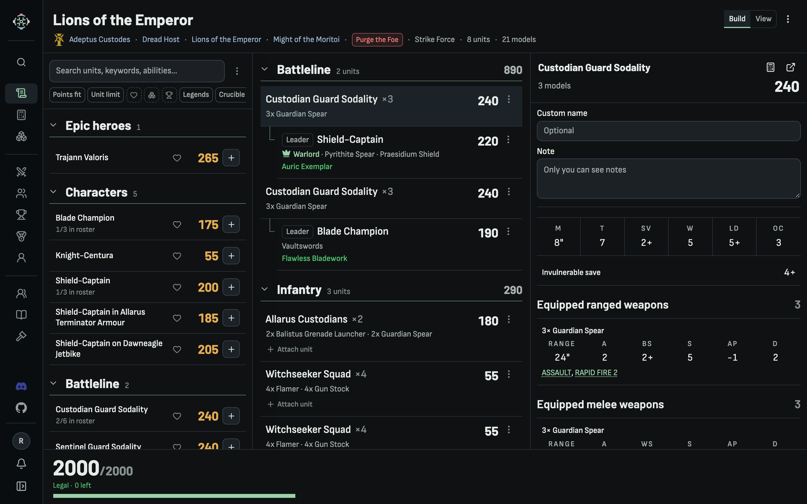
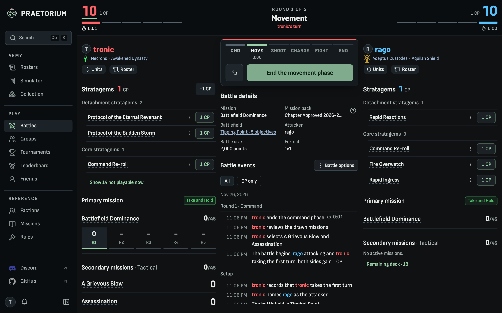

<div align="center">


# Praetorium

Build your army, test your matchups and track every game of Warhammer 40,000, from setup to final score.

[praetorium.gg](https://praetorium.gg/?utm_source=github&utm_medium=profile&utm_campaign=readme) · [Discord](https://discord.gg/RFUMZNFwMu)

[](https://apps.apple.com/app/praetorium-gg/id6806875244) [](https://praetorium.gg/docs/mobile-app?utm_source=github&utm_medium=profile&utm_campaign=readme#get-the-app) [![ChatGPT](https://img.shields.io/badge/ChatGPT-plugin-10A37F?logo=)](https://chatgpt.com/plugins/plugin_asdk_app_6adb29330cd08191b5833c45b0fffc79) [](https://claude.ai/directory/praetorium)

[](https://github.com/richardsolomou/praetorium.gg/actions/workflows/ci.yml) [](LICENSE)

</div>

<div align="center">




</div>

Praetorium is a free, open source Warhammer 40,000 army builder, combat simulator and battle tracker. Build lists checked against the current points and list-building rules, import them from other apps, and share them. Compare units in the combat simulator. Track 1v1, 2v1 or 2v2 games turn by turn, with missions, scoring, command points and turn times.

Groups keep a running leaderboard for people who play together, run leagues, and hold hidden-list games. Tournaments have everyone seal a list in secret, then play open or Swiss rounds from a shared results table. Anyone can watch battles and read the leaderboard.

Praetorium runs in the browser, as an iPhone and Android app that keeps working offline, and inside ChatGPT and Claude.

## Scope

Praetorium does not provide matchmaking, chat, or rules written by this project. An account is required to save a list, start or join a battle, or join a group or tournament. Without one you can build a list, browse the reference, run the simulator, watch any battle and read the leaderboard.

This repository contains source pins and authored correction patches in `catalogue/`, but no fetched upstream catalogues, copied rules prose, or generated snapshots. The service uses verified snapshots from the configured community sources.

## Use

[praetorium.gg](https://praetorium.gg/?utm_source=github&utm_medium=profile&utm_campaign=readme) is the supported service. It keeps the community rules data current and saves your rosters and battles. The public reference needs no account: [faction datasheets](https://praetorium.gg/factions?utm_source=github&utm_medium=profile&utm_campaign=readme), [missions](https://praetorium.gg/missions?utm_source=github&utm_medium=profile&utm_campaign=readme), and [rules](https://praetorium.gg/rules?utm_source=github&utm_medium=profile&utm_campaign=readme). The [docs](https://praetorium.gg/docs?utm_source=github&utm_medium=profile&utm_campaign=readme) explain how to use each part.

To use Praetorium from an AI assistant, install it from [ChatGPT's plugin directory](https://chatgpt.com/plugins/plugin_asdk_app_6adb29330cd08191b5833c45b0fffc79) or [Claude's connector directory](https://claude.ai/directory/praetorium), or add the remote MCP server `https://praetorium.gg/mcp` to any assistant that supports one. No API key is needed. In Claude Code:

```sh
claude mcp add --transport http praetorium https://praetorium.gg/mcp
```

## Development

See [Contributing](CONTRIBUTING.md) to run the app and its checks, [Architecture](docs/development/architecture.md) for code placement, and [AGENTS.md](AGENTS.md) for coding-agent rules.

## Data and trademarks

Catalogue definitions come from [BSData](https://github.com/richardsolomou/wh40k-11e). Rules summaries, stratagems and mission packs come from [VS Data](https://github.com/richardsolomou/vs-data), and detachment data from [Game Datacards](https://github.com/game-datacards/datasources). See [`catalogue/sources.json`](catalogue/sources.json) for all sources.

Warhammer 40,000 and related marks belong to Games Workshop. Praetorium is unofficial and is not endorsed by Games Workshop.

Praetorium is licensed under the [GNU Affero General Public License v3.0](LICENSE).
